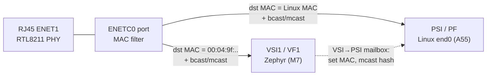

# One Ethernet port, two operating systems

## Data path



- The **PF** (physical function, "PSI") belongs to Linux (`fsl-enetc4`). It configures the PHY, link
  speed, pause frames and the port MAC filter.
- **VF1** ("VSI1") belongs to the M7. It has its own RX/TX rings, interrupts (MSI-X → MSGINTR1 on
  the M7) and MAC address, and it never touches the PHY. The M7 asks the PF to install its MAC
  through the hardware VSI→PSI mailbox. Linux only honors that because the VF is *trusted*.
- Unicast frames go to whichever station interface owns the destination MAC. Broadcast and
  multicast are replicated to both. Traffic between Linux and the M7 is switched inside the ENETC
  and never leaves the board.

## Who sets it up

| Step | Where | What |
|---|---|---|
| Resource ownership | SM config `mx95devenv` | M7 owns `NETC_VSI1` and `NETC_LDID3` (MSI/stream ID), and gets read-only access to `NETC_ECAM` and `NETC0` |
| VF creation | `m7-vf-handoff.service` (Linux) | `sriov_drivers_autoprobe=0`, `sriov_numvfs=2`, Bus Master + MSI-X enable in VF1's config space, `ip link set end0 vf 1 trust on` |
| VF driver | Zephyr `nxp,imx-netc-vsi` on `enetc0_vsi1` | waits for the PF's VF-enable bits, then brings up the SI and requests its MAC |
| Addressing | Zephyr DHCPv4 | the M7 gets its own lease |

Config file: `/etc/default/m7-vf-handoff` (`PF_PCI`, `PF_NETDEV`, `VF`, `NUMVFS`).

## Testing

```sh
# On the board (Linux pane)
ip link show end0                    # "vf 1 ... trust on" listed under end0
journalctl -b -u m7-vf-handoff
# M7 pane
m7 status                            # carrier up, mac 00:04:9f:.., ipv4 a.b.c.d
net ping <your-router>

# From the board or any LAN host
ping <m7-ip>
echo hello | nc -u -w1 <m7-ip> 7     # UDP echo from the M7
iperf3 -c <m7-ip>                    # (needs an iperf server on the M7; not in m7-netipc)

# Watch frames on the Linux side (Linux only sees its own + bcast/mcast)
tcpdump -i end0 -n ether host 00:04:9f:xx:xx:xx
```

## Tweaks

- **VLAN for the M7**: `ip link set end0 vf 1 vlan 100` makes the PF tag and untag VF traffic.
  The M7 then sits on VLAN 100 without knowing it.
- **Fixed MAC for the M7**: replace `zephyr,random-mac-address` in the overlay with
  `local-mac-address = [00 04 9f 12 34 56];`, so DHCP reservations are possible.
- **Local-only link** (no LAN): give both sides static addresses in the same subnet. They still
  talk through the ENETC internal path, with or without a cable.
- **PTP**: the NETC timer is Linux's (`ptp4l -i end0`, from `linuxptp`, in the image).
- **Other ports**: ENETC1 (60-pin PHY card connector) and ENETC2 (10G AQR113C) can be split the same
  way. Change the SM cfg (`NETC_VSI3`/`NETC_LDID5` for ENETC1 VF1, `NETC_VSI5`/`NETC_LDID7` for
  ENETC2 VF1), the overlay (`enetc1_vsi1`/`enetc2_vsi1`) and `PF_PCI` together.

## When it doesn't work

| Symptom | Likely cause |
|---|---|
| M7 `m7 status`: VF present, carrier down forever | `m7-vf-handoff` failed (no VFs) or the PF link is down. Check `journalctl -u m7-vf-handoff`, `ethtool end0` |
| M7 only receives broadcasts | VF not trusted (`ip link show end0`), so the MAC filter request was denied |
| M7 hard-faults when the VSI comes up | SM config not `mx95devenv` (VSI1 still owned by the AP), so the access is blocked. Check the boot image build |
| Linux binds `fsl_enetc_vf` to the VF | autoprobe wasn't disabled before `sriov_numvfs`. Run `m7-vf-handoff` again |
